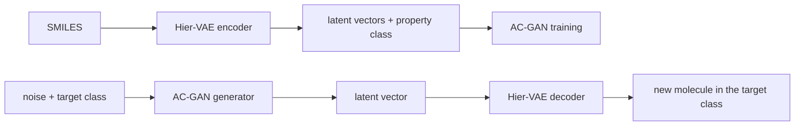

# AC-ModNet

Code for **"AC-ModNet: Molecular Reverse Design Network Based on Attribute Classification"**,
*International Journal of Molecular Sciences* 25(13), 6940 (2024).
[Paper](https://www.mdpi.com/1422-0067/25/13/6940) · DOI [10.3390/ijms25136940](https://doi.org/10.3390/ijms25136940)

AC-ModNet generates molecules that fall into a chosen **property class** (logP, QED or
synthetic accessibility). A conditional GAN (AC-GAN) learns to produce molecular latent
vectors for each class, and a pre-trained hierarchical graph VAE (Hier-VAE) decodes them
into molecules.



## Property classes

| Property | Classes | Bin edges (left-open intervals) |
|---|---|---|
| logP | 6 | 0, 1, 2, 3, 4 |
| QED | 6 | 0.5, 0.6, 0.7, 0.8, 0.9 |
| SAscore | 7 | 2.0, 2.5, 3.0, 3.5, 4.0, 4.5 |

All bins live in [`acmodnet/properties.py`](acmodnet/properties.py), so labeling, training
and evaluation always use the same definition.

## Results reported in the paper (ZINC-250K, CNN backbone)

| Property | Validity | Uniqueness | Novelty |
|---|---|---|---|
| logP | 100% | 59.67% | 99.41% |
| QED | 100% | 54.15% | 98.64% |
| SAscore | 100% | 73.59% | 98.86% |

Per-class accuracy (share of generated molecules that land in the target class) is listed in Table 2 of the paper.

## Installation

```bash
pip install -r requirements.txt     # PyTorch, RDKit, networkx, pandas, tqdm
pytest -q                           # end-to-end smoke test on CPU, about 30 s
```

> **RDKit version matters for the vocabulary.** The motif vocabulary depends on RDKit's
> canonical SMILES, which changed between releases. `data/vocab_zinc250k_rdkit2020.txt`
> is the vocabulary used in the paper (RDKit 2020.09). To use it, or checkpoints trained
> with it, create the legacy environment in `environment-legacy.yml`. With a current RDKit,
> rebuild the vocabulary (step 1) and train the VAE from scratch.

## Usage

Every step is a module run with `python -m acmodnet.<step>`; `--help` lists all options.
The GPU is used when available; set `ACMODNET_DEVICE=cpu` (or `cuda:1`, ...) to choose.

```bash
# 1. Motif vocabulary and property labels for ZINC-250K
python -m acmodnet.get_vocab --data data/zinc250k.txt.gz --out data/vocab.txt --ncpu 8
python -m acmodnet.label     --data data/zinc250k.txt.gz --out data/zinc250k_labeled.csv --ncpu 8

# 2. Pre-train the Hier-VAE
python -m acmodnet.preprocess --data data/zinc250k.txt.gz --vocab data/vocab.txt --out data/vae_tensors --ncpu 8
python -m acmodnet.train_vae  --train data/vae_tensors --vocab data/vocab.txt --save_dir ckpt/vae --epoch 20

# 3. Encode molecules into latent vectors labeled by one property (logp | qed | sas)
python -m acmodnet.encode --data data/zinc250k_labeled.csv --property logp \
    --vocab data/vocab.txt --model ckpt/vae/model.ckpt.final --out data/latent_logp.pt

# 4. Train the AC-GAN
python -m acmodnet.train_gan --data data/latent_logp.pt --save_dir ckpt/gan_logp --n_epochs 40

# 5. Generate molecules for every class and evaluate them
python -m acmodnet.generate --gan ckpt/gan_logp/gan_last.pt --model ckpt/vae/model.ckpt.final \
    --vocab data/vocab.txt --property logp --n_per_class 1000 --out results/logp_generated.csv
python -m acmodnet.evaluate --generated results/logp_generated.csv \
    --train data/zinc250k.txt.gz --out results/logp_metrics.csv
```

`evaluate` reports, for each target class and their mean: validity, uniqueness, novelty
(not in the training set, by canonical SMILES), accuracy (computed property falls in the
target class) and agreement with the discriminator's predicted class.

Checkpoints from the original code (GAN saved as a `(generator, discriminator, optimizer)`
tuple) load in `generate` too; pass the GAN architecture flags used in training, e.g.
`--n_classes 6 --img_size 64 --channels 6 --deep_dim 512`.

## Model

**Hier-VAE** ([Jin et al., 2020](https://arxiv.org/abs/2002.03230)) encodes a molecular graph
hierarchically (atoms, attachments, motifs) and decodes motif by motif. Its encoder output
(`hidden_size` = 250) is the space the GAN learns.

**AC-GAN** ([`acmodnet/gan.py`](acmodnet/gan.py)):

* *Generator*: class embedding × noise → linear layers → a 6×64×64 feature map refined by
  convolution blocks → linear projection to a 250-d latent vector.
* *Discriminator*: latent vector → linear projection to a 6×64×64 map → four strided
  convolution blocks → a real/fake head and a property-class head.
* *Training* ([`acmodnet/train_gan.py`](acmodnet/train_gan.py)): weighted adversarial and
  classification losses, a distance term that keeps generated vectors near the data, and an
  adaptive balance that gives the generator extra updates while the discriminator dominates.

## Repository layout

```
acmodnet/
  properties.py   logP / QED / SAscore and their class bins
  get_vocab.py    motif vocabulary
  label.py        property values and classes for a SMILES list
  preprocess.py   graph tensors for VAE training
  train_vae.py    Hier-VAE pre-training
  encode.py       molecules -> latent vectors + labels
  gan.py          AC-GAN generator and discriminator
  train_gan.py    AC-GAN training
  generate.py     class-conditioned generation
  evaluate.py     validity / uniqueness / novelty / accuracy
hgraph/           Hier-VAE, vendored from hgraph2graph (MIT), see THIRD_PARTY_NOTICES.md
data/
  zinc250k.txt.gz                 ZINC-250K SMILES (249,455 molecules)
  vocab_zinc250k_rdkit2020.txt    vocabulary used in the paper
tests/            end-to-end smoke test
```

## Citation

```bibtex
@article{wei2024acmodnet,
  title   = {AC-ModNet: Molecular Reverse Design Network Based on Attribute Classification},
  author  = {Wei, Wei and Fang, Jun and Yang, Ning and Li, Qi and Hu, Lin and Zhao, Lanbo and Han, Jie},
  journal = {International Journal of Molecular Sciences},
  volume  = {25},
  number  = {13},
  pages   = {6940},
  year    = {2024},
  doi     = {10.3390/ijms25136940}
}
```

## License

MIT, see [LICENSE](LICENSE). The `hgraph/` package is © Wengong Jin, Regina Barzilay and
Tommi Jaakkola under the MIT license.
